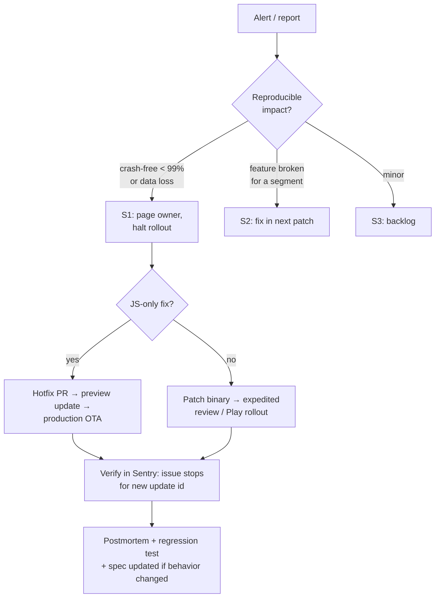

# 6. Builds to App Store and Google Play; Bugs, Errors and Performance in Production

## 6.1 One-time setup

| Step | iOS | Android |
|------|-----|---------|
| Developer account | Apple Developer Program (paid, yearly) | Google Play Console (one-time fee); identity verification |
| App identifiers | Bundle ID `com.<org>.tidytasks` — set in `app.config.ts` | Package `com.<org>.tidytasks` — **permanent** |
| Store record | App Store Connect → New App → note the **Apple ID (ascAppId)** | Play Console → Create app |
| Signing | `eas credentials` — EAS creates/stores distribution cert + provisioning profile | EAS generates upload keystore; enroll in **Play App Signing** |
| Submit credentials | App Store Connect API key (Issuer ID, Key ID, .p8) uploaded to EAS | Google Cloud service account JSON with Play Console access, uploaded to EAS |
| First Android upload | Play requires the **first** AAB to be uploaded manually in the Console (once); after that `eas submit` works | |
| Expo project | `npx eas-cli@latest login` → `npx eas-cli@latest init` (writes `extra.eas.projectId`) | same |

## 6.2 Release procedure (`/release` skill automates the repo steps)

1. **Cut**: on `main`, all release specs `Implemented`, CI green.
2. **Version**: bump `version` in `app.config.ts` (SemVer); build numbers are remote/auto.
3. **Changelog**: `CHANGELOG.md` + store "What's new" text (`store/release-notes/<version>.md`).
4. **Preview build & QA**: `eas build --profile preview --platform all` → run the QA checklist (`docs/qa-checklist.md`) on at least one low-end Android and one older iPhone.
5. **Tag**: `git tag v1.0.0 && git push --tags` → `release.yml` builds `production` and submits to **TestFlight** and **Play internal testing**.
6. **Beta**: TestFlight external group / Play closed track for 2–7 days. Watch Sentry for the new release.
7. **Store review**: submit for review in App Store Connect (attach build, metadata, privacy answers, review notes). Promote in Play Console to production.
8. **Staged rollout**: Play 10% → 50% → 100% (24 h between steps if healthy). Apple: **phased release** over 7 days.
9. **Go / no-go per step**: crash-free users ≥ 99.5%, no new S1/S2 issues, ANR < 0.47%, no spike in 1-star reviews.
10. **Post-release review** at 48 h → `docs/releases/<version>.md`.

## 6.3 OTA updates (EAS Update)

- Only JS/asset changes. Runtime version policy `appVersion` ensures an update is never delivered to an incompatible binary.
- Flow: `eas update --channel preview` → verify on preview build → `eas update --channel production --message "fix: …"` (**human-only**, blocked for agents by hook).
- Upload source maps for each update: `npx sentry-expo-upload-sourcemaps dist`.
- Rollback: republish the previous update group or `eas update:rollback`.
- Do not use OTA to change app purpose/functionality materially — store policies require review for that.

## 6.4 Observability stack

| Signal | Tool | Where to look |
|--------|------|---------------|
| JS & native crashes, unhandled promise rejections | Sentry | Issues, filtered by `release` |
| Release health (crash-free users/sessions, adoption) | Sentry Releases | per version + dist |
| Performance: app start, slow/frozen frames, screen load | Sentry Performance (tracing enabled with sample rate) | Mobile Vitals |
| Android Vitals: ANR, crash rate, excessive wakeups, battery | Play Console | Quality → Android Vitals |
| iOS crashes, hangs, energy, disk writes | Xcode Organizer / App Store Connect | Metrics + Crashes |
| User feedback | Store reviews, support inbox, TestFlight feedback | weekly review |

Sentry configuration rules (implemented in `src/lib/monitoring.ts`):
`sendDefaultPii: false`, environment = build profile, `tracesSampleRate` 0.2 in production,
`beforeSend` strips user-entered text, source maps uploaded on every build/update.

## 6.5 Triage runbook

**With the `prod-triage` agent** (`/triage-crash <sentry-issue-url>`):
1. Agent pulls the issue, stack trace, breadcrumbs, affected releases/devices through the Sentry MCP.
2. Maps frames to source (source maps make this exact), finds the commit range via GitHub MCP.
3. Produces: root-cause hypothesis, reproduction steps, severity proposal, a **task brief** (chapter 3 format) with a regression test requirement.
4. Human decides severity and hotfix path; `implementer` takes the brief.

## 6.6 Performance problems — checklist

| Symptom | Likely cause | Check / fix |
|---------|--------------|-------------|
| Slow cold start | Heavy work at import time, large sync storage reads, many SDK inits | Sentry app-start spans; defer non-critical init; lazy load screens |
| Janky list | Re-rendering rows, inline functions, images not sized | `React.memo` rows, `keyExtractor`, `getItemLayout`, FlashList for very large lists |
| Frozen frames on tap | Synchronous JS work / large JSON parse on JS thread | Move to async, batch SQL in a transaction, paginate |
| Memory growth | Listeners not removed, unbounded caches | Profile in release build; cleanup in `useEffect` return |
| ANR (Android) | Main-thread native work, sync disk I/O from native modules | Android Vitals ANR clusters; use async APIs |
| Battery / wakeups | Polling, background tasks | Replace polling with push / background fetch limits |

Always profile **release** builds (`preview` profile) — dev builds are much slower and misleading.
