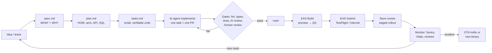

# Mobile Delivery Playbook — React Native (Expo) from Spec to Store

This playbook is the operating manual for taking a React Native app from a written
specification to a live release on the **App Store** and **Google Play**, and for
supporting it afterwards. It is written for a lead who works with **AI coding agents**
(Claude Code) as the main implementers and acts as spec owner, reviewer and release owner.

The reference implementation is this repository: **Tidy Tasks**, a small offline-first
task list built with Expo SDK 58 / React Native 0.88.

| # | Chapter | What you get |
|---|---------|--------------|
| 1 | [Production & support requirements](01-production-requirements.md) | Non-functional requirements, store policy checklist, SLOs, support model |
| 2 | [Spec-Driven Development (SDD)](02-spec-driven-development.md) | Constitution → spec → plan → tasks → implement → verify, with templates |
| 3 | [Tasking AI agents, code review](03-ai-agent-tasking-and-review.md) | Task brief format, review checklist, PR gates, what never to delegate |
| 4 | [Backend, API, SQL, integrations](04-backend-api-sql-integrations.md) | Contract-first API changes, migration rules, change log, third-party services |
| 5 | [Agent configuration & automation](05-agent-configuration.md) | CLAUDE.md, subagents, skills, hooks, MCP servers, CI automation |
| 6 | [Release, monitoring, production triage](06-release-and-production.md) | EAS build/submit, store review, staged rollout, crash/perf triage, OTA hotfix |

## The lifecycle at a glance

## Roles

| Role | Human or agent | Owns |
|------|----------------|------|
| Product / spec owner | Human | `spec.md` acceptance criteria, scope decisions |
| Tech lead / reviewer | Human (+ `code-reviewer` agent) | `plan.md`, merge decisions, architecture |
| Implementer | `implementer` agent | Code + tests for one task |
| Backend integrator | `backend-integrator` agent + human DBA review | API contract, SQL migrations, integration changes |
| Release engineer | Human (+ `release-engineer` agent) | Builds, store listings, rollout, rollback |
| On-call / triage | Human (+ `prod-triage` agent) | Crash and performance triage, hotfix decision |

**Rule of thumb:** agents may *propose* anything, but a human approves every spec,
every merge to `main`, every DB migration on shared environments, and every store release.
